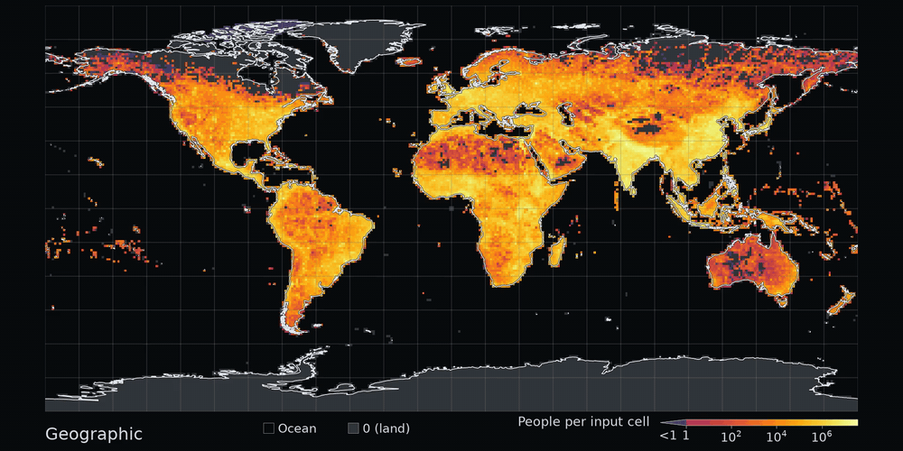
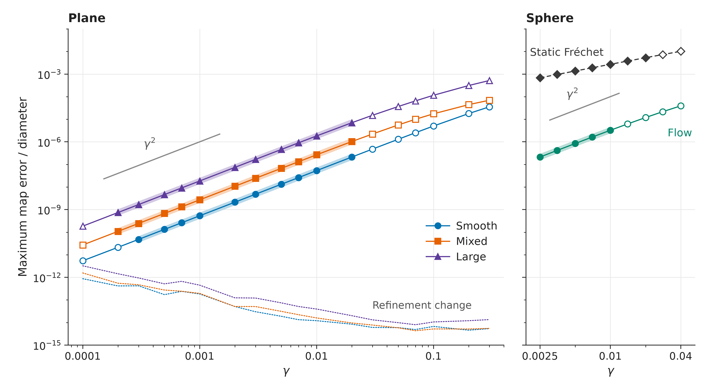
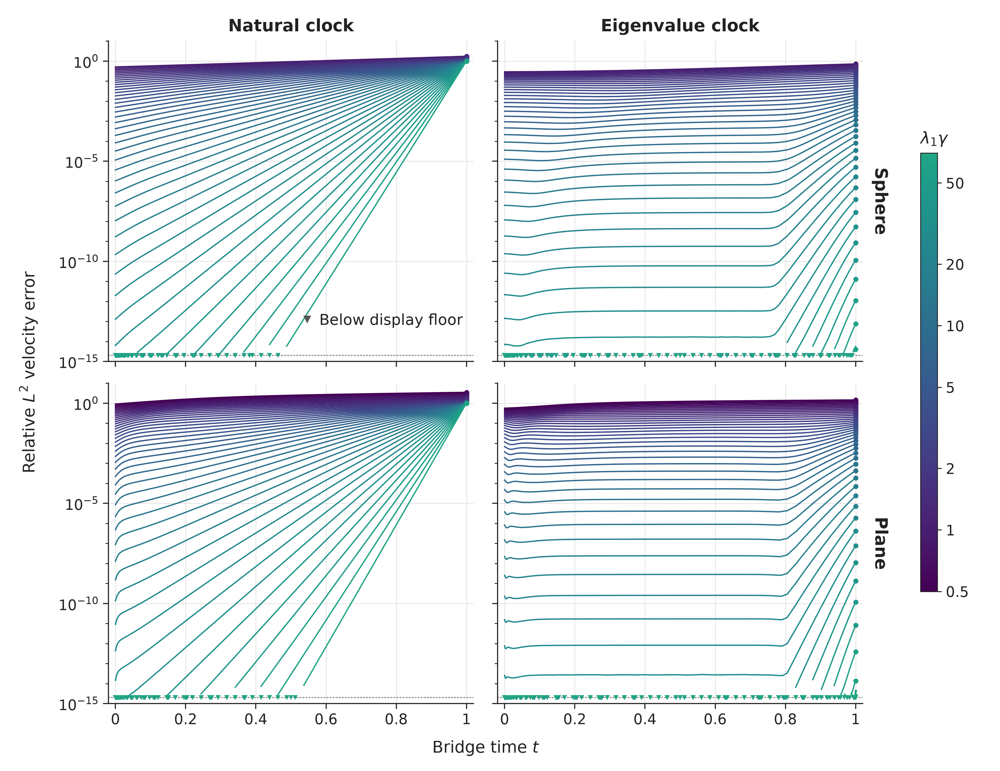

A cartogram is a map resized by population. Two classical ways to make one are optimal transport, which minimises movement, and diffusion, which spreads population like heat. A Schrödinger bridge is a noisy path between two distributions. This work derives and numerically checks a quadratic approach to optimal transport and the clock needed to recover diffusion. One noise dial connects the two classical cartograms.

World population across [40 bridge maps](docs/world-map.md) at γ = 0.002 to 30 and a separate diffusion map, with colour filled from the nearest mapped cell centres. Motion interpolates neighbouring bridge maps; cuts separate geography, the two solvers and diffusion.

## Approach optimal transport quadratically

As noise falls, the flow-map error follows a quadratic law on smooth test problems: fitted exponents **1.9994 ± 0.0002** on the plane and **2.019 ± 0.002** on the sphere, using a two-term fit. [Measurements and fit limits](docs/measurements.md#transport-measurements).

Map errors are measured against known transport maps. Filled points enter the fits, open points do not, and pale bands trace the fitted flow models.

## Match diffusion throughout the path

At large noise, a clock set by the slowest heat-decay rate matches the bridge velocity to Gastner-Newman diffusion along the path. The curves below show why early agreement alone misses the endpoint problem. [Clock and derivation](docs/limits.md#the-eigenvalue-clock).

The natural clock leaves an endpoint error near one; the eigenvalue clock removes it. Downward triangles mark samples below the $`2\times10^{-15}`$ display floor, including stored zeros.

## What this does not show

- A general transport theorem: the quadratic rate is derived under hypothesis (H) and confirmed numerically on smooth examples; the sphere fit spans only 0.6 decades. [Assumptions](docs/limits.md#transport-end-a-conditional-quadratic-rate).
- A refereed clock result or an established fastest clock: convergence is derived, the no-faster-rate argument is formal, and plotted times are samples. [Scope](docs/limits.md#the-eigenvalue-clock).
- A world-population rate, spherical world map, distortion ranking or speed comparison: the one-degree flat-map illustration is separate from these measurements. [World map](docs/world-map.md).

## How to use it

Load the [stored arrays](results/README.md), [check every headline](REPRODUCE.md), or use the [flat-map Python API](bcart/README.md) with your own positive cell masses. The numerical kernels can also be ported independently. Our code, text and synthetic results are [CC0 1.0](LICENSE); population inputs and derived maps retain [CC BY 4.0](LICENSES/CC-BY-4.0.md). The [transport-cartogram preprint and public code](docs/limits.md#references) provide the preceding construction.
